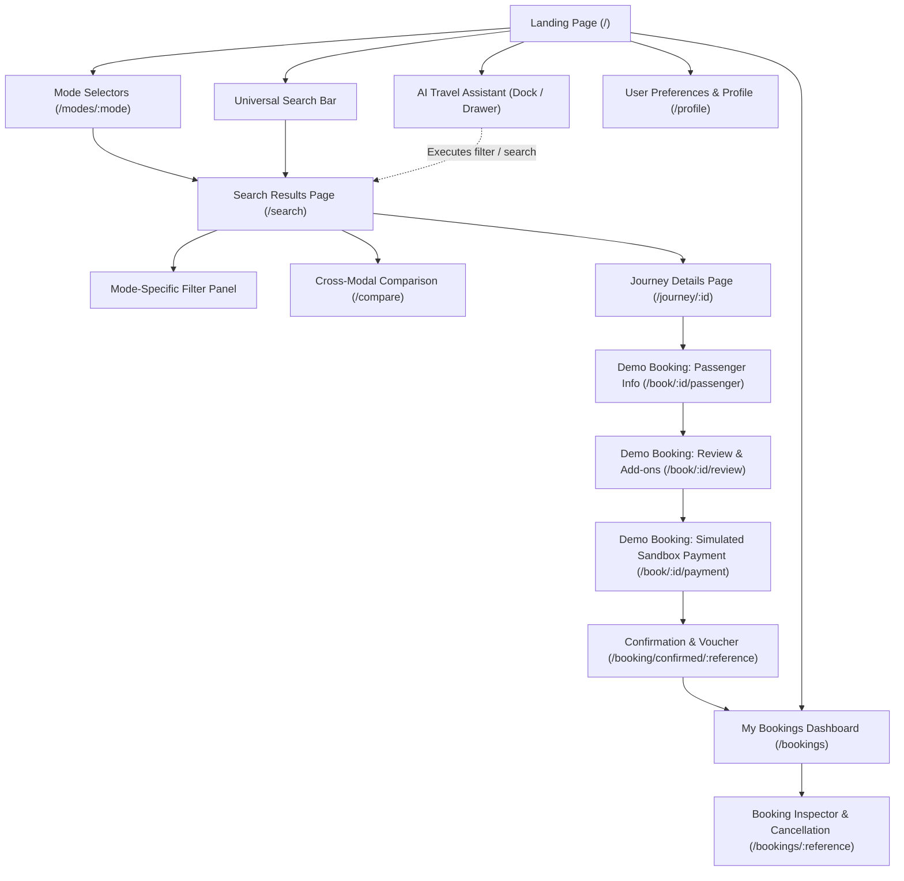
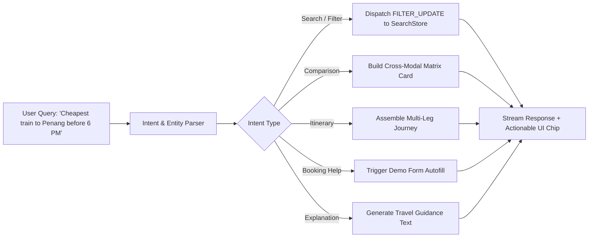
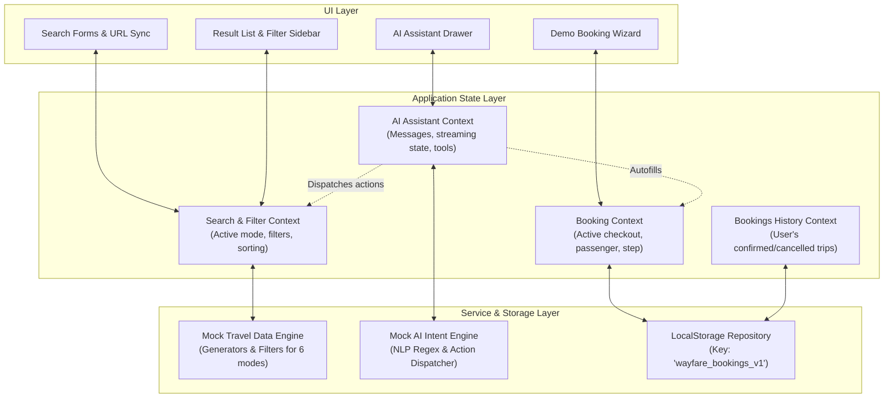

# Wayfare AI — Phase 1 Implementation Plan & Architecture Specification

**Document Version:** 1.0.0  
**Status:** Under Review (Planning Only)  
**Target Milestone:** Prototype MVP  
**Author:** Senior Software Architect & UI/UX Product Engineering Lead  

---

## 1. Executive Summary

**Wayfare AI** is an AI-powered, multi-modal travel booking prototype web application. Modern travel planning is heavily fragmented across siloed platforms: ride-hailing apps for local micro-transit, regional rail portals for trains, transit authority apps for metro transit, intercity bus ticketing engines, and online travel agencies (OTAs) for flights.

Wayfare AI bridges this fragmentation by establishing a unified travel exploration, cross-modal comparison, and simulated booking environment powered by an integrated, context-aware AI Travel Assistant across **six distinct transportation modes**:

1. **Cabs and Taxis** (On-demand & pre-scheduled point-to-point urban transit)
2. **Autos and Auto-Rickshaws** (Last-mile, rapid urban transit)
3. **Metro** (Urban rapid transit & light rail networks)
4. **Buses** (Intercity express coaches & regional bus lines)
5. **Trains** (High-speed rail, intercity passenger trains, and commuter railways)
6. **Flights** (Domestic and international commercial air travel)

The core differentiator is that the **AI Assistant is not an isolated chatbot** relegated to a floating widget; it is deeply embedded into the journey discovery, filtering, multi-modal comparison, demo checkout, and trip management workflows.

> **Prototype Scope Disclaimer:**  
> Wayfare AI is an illustrative prototype. No live transportation APIs, Global Distribution Systems (GDS), banking gateways, payment processing, or live ticket issuance mechanisms are integrated. All search results, availability states, transit routes, and booking confirmations are simulated with realistic, consistent mock data.

---

## 2. Repository Inspection Findings

A thorough inspection of the workspace environment was performed prior to drafting this architecture:

* **Workspace Directory:** `/Users/muszainimusa/lawflow/backend/app/tasks/Vibe coding ticketing`
* **Directory State:** Completely pristine and empty. No pre-existing source files, package manifests, git repositories, or configuration files were detected.
* **Runtime Environment:**
  * **Node.js:** `v24.21.0` (modern LTS/Current runtime with native ES module support).
  * **npm:** `11.19.0`.
  * **Git:** `2.39.5` (Apple Git-154).
  * **Operating System:** macOS (Darwin arm64/x86_64).
* **Existing Framework & Dependencies:** None. No legacy framework lock-in or outdated build tooling exists.
* **Environment & Secrets:** No `.env` or credential files exist in the repository. No secrets were exposed or accessed.
* **Technical Readiness:** The environment is primed for a modern, lightweight, lightning-fast frontend stack (Vite + React 18/19 + TypeScript).

---

## 3. Current Architecture & Reusable Assets

Because the workspace is greenfield:
* **Existing Architecture:** None.
* **Reusable Code / Assets:** None.
* **Architectural Opportunity:** We can implement a clean, domain-driven modular architecture from scratch without accommodating technical debt, outdated dependencies, or conflicting CSS systems. The design tokens, mock data stores, routing, and AI service layers will be designed with clean abstraction boundaries, making future replacement with live production backends straightforward.

---

## 4. Product Requirements

### 4.1 Product Vision
Wayfare AI provides travelers with an intuitive, unified interface to discover, evaluate, compare, and simulate travel bookings from doorstep to destination. By pairing clean visual comparison tools with an intelligent conversational co-pilot, users can answer complex multimodal questions (e.g., *"What is the fastest way to travel from KL Sentral to Penang under RM100?"*) and act on the results within seconds.

### 4.2 Target Personas
1. **The Multimodal Commuter:** Navigates daily urban environments utilizing combinations of cabs, autos, and metro rail; prioritizes transfer efficiency, real-time arrival estimates, and flat pricing.
2. **The Budget Intercity Explorer:** Compares buses vs. trains vs. low-cost carriers for domestic and regional travel; evaluates trade-offs between journey duration and fare.
3. **The Executive & Family Traveler:** Books flights and express rail; prioritizes luggage allowance, seat comfort, direct routes, and seamless doorstep cab connections.
4. **The Conversational Planner:** Prefers natural-language instructions over fiddling with multi-tiered filter dropdowns; relies on AI to synthesize and execute travel plans.

### 4.3 Core Functional Requirements
* **Universal Travel Discovery:** A centralized search hero capable of routing queries to any of the 6 transit modes or initiating a cross-modal comparison.
* **Mode-Specific Search Pages:** Six dedicated search portals with specialized input controls tailored to each mode's physical realities.
* **Adaptive Search Results & Filters:** Dynamic results lists matching mode-specific mental models (e.g., station interchange maps for Metro vs. multi-class baggage allowances for Flights).
* **Cross-Modal Journey Comparison:** Direct side-by-side matrices comparing travel time, illustrative cost, comfort level, and convenience across different modes for the same origin/destination corridor.
* **Ubiquitous AI Travel Assistant:** Omnipresent co-pilot capable of conversational filtering, itinerary assembly, natural-language search, and booking assistance.
* **Multi-Step Demo Booking Flow:** Seamless 4-step fictional booking pipeline (Passenger details -> Add-ons & Seat selection preview -> Simulated Payment Sandbox -> Instant Booking Voucher).
* **My Bookings Dashboard:** Reactive local trip management dashboard supporting status inspection, simulated trip cancellation, and downloadable mock boarding passes/tickets.
* **Travel Preferences & Profile:** User profile module to store fictional loyalty credentials, seat preferences, and default payment nicknames.

---

## 5. User Journeys and Navigation Map

### 5.1 End-to-End Navigation Architecture



### 5.2 Primary User Journeys
1. **Journey A: Quick Search to Instant Demo Booking**  
   User lands on `/` $\rightarrow$ selects "Trains" $\rightarrow$ inputs "KL Sentral" to "Butterworth (Penang)" $\rightarrow$ views filtered ETS train options $\rightarrow$ selects "Business Class" $\rightarrow$ fills mock passenger info $\rightarrow$ confirms sandbox payment $\rightarrow$ receives booking reference `WF-TR-90412` $\rightarrow$ views ticket in My Bookings.
2. **Journey B: Conversational AI-Led Itinerary**  
   User opens AI Assistant from any page $\rightarrow$ types *"Find me the cheapest way to travel from KL to Singapore departing tomorrow morning"* $\rightarrow$ AI queries mock bus and train datasets $\rightarrow$ returns a comparison card in chat $\rightarrow$ user clicks "Apply to Results" $\rightarrow$ results table automatically updates $\rightarrow$ user proceeds to checkout.
3. **Journey C: Cross-Modal Tradeoff Comparison**  
   User navigates to `/compare` $\rightarrow$ inputs Origin: "Kuala Lumpur", Destination: "Penang" $\rightarrow$ system displays 4 concurrent mode columns (Flight: 1h 05m / RM180; Train: 4h 15m / RM85; Bus: 5h 30m / RM45; Cab/Intercity: 4h 00m / RM380) $\rightarrow$ user chooses the balanced option (Train).

---

## 6. Page Inventory

| # | Route | Page / View Name | Purpose & Primary Features | Key Components | AI Integration Point |
|---|---|---|---|---|---|
| 1 | `/` | **Landing Page** | Brand presentation, universal search hero, mode quick-launcher, trending routes, feature showcase, testimonials. | HeroSearch, ModeGrid, ValueProps, TestimonialCards, Footer | Floating AI launcher, AI natural-language prompt chips |
| 2 | `/modes/:mode` | **Mode Hubs** | Dedicated landing portals for each mode (e.g. `/modes/flights`, `/modes/metro`) highlighting mode-specific perks and fast-search presets. | ModeHero, PresetsCarousel, ModeFAQ, QuickSearchCard | Contextual prompt suggestions tailored to selected mode |
| 3 | `/search` | **Search Results & Discovery** | Comprehensive search results display, mode tabs, sort toggles, dynamic filter sidebar, map/timeline teaser. | ResultList, ResultCard, FilterSidebar, SortBar, Breadcrumbs | "Refine with AI" toolbar; real-time conversational filter sync |
| 4 | `/compare` | **Cross-Modal Comparison** | Side-by-side multimodal matrix comparing time, cost, comfort, baggage, and carbon output across available modes. | ComparisonTable, MatrixColumn, TradeoffRadar, RecommendationCard | "Ask AI to Recommend" button providing personalized tradeoffs |
| 5 | `/journey/:id` | **Journey Details** | Granular segment-by-segment timeline (stops, interchanges, amenities, policies, operator details). | SegmentTimeline, AmenityGrid, FareRulesCard, BookingCTA | "Explain Route & Transfers" conversational breakdown |
| 6 | `/book/:id/*` | **Demo Booking Wizard** | 3-step checkout flow (Step 1: Passenger, Step 2: Customization & Add-ons, Step 3: Simulated Payment). | StepIndicator, PassengerForm, AddonSelector, PriceBreakdown, SandboxPayCard | "Autofill Demo Passenger" AI shortcut; fare breakdown explanations |
| 7 | `/booking/confirmed/:ref` | **Booking Confirmation** | Booking confirmation voucher, downloadable mock boarding pass, QR code simulation, trip timeline. | VoucherCard, BarcodeMock, ActionButtons, ShareModal | "Add Doorstep Cab Connection" AI itinerary expander |
| 8 | `/bookings` | **My Bookings Dashboard** | Management view of all simulated upcoming, completed, and cancelled trips stored in local state. | BookingGrid, StatusFilterTabs, EmptyState, BookingCard | "Manage My Trips" natural-language trip query agent |
| 9 | `/bookings/:ref` | **Booking Inspector** | Detailed view of a specific booking with simulated cancellation, status modification, and ticket print view. | TicketDetailView, CancellationDialog, RefundSimulator | Guided simulated cancellation dialog with penalty policy explanations |
| 10 | `/profile` | **Profile & Preferences** | User settings for travel persona, default currency, simulated reward loyalty numbers, emergency contacts. | PreferenceToggles, PersonaSelector, SavedPassengersList | AI personalization tune-up based on travel styles |

---

## 7. Transportation-Specific Search and Filtering Specification

Each transportation mode operates on distinct physical constraints and user expectations. The table below delineates the search inputs, mode-specific filters, and presentation layouts:

```
+---------------------------------------------------------------------------------------------------+
|                                 UNIVERSAL BASE PARAMETERS                                         |
|  - Origin / Pickup Location         - Destination / Dropoff Location        - Departure Date/Time  |
|  - Passenger / Seat Count           - Sort By (Price, Duration, Departure, Recommended)          |
+---------------------------------------------------------------------------------------------------+
```

### 7.1 Detailed Mode Matrix

| Mode | Search Inputs | Mode-Specific Filters | Result Card Layout | Illustrative Mock Data Indicators |
|---|---|---|---|---|
| **1. Cabs & Taxis** | Pickup point, dropoff point, ride timing (Now vs. Schedule) | • Vehicle Category (Hatchback, Sedan, SUV, Luxury, EV)<br>• Max Passengers (1-6)<br>• Luggage Capacity (1-4 bags)<br>• ETA to pickup (<5m, <10m)<br>• Driver Rating (4.5+) | Compact ride-dispatch card: vehicle silhouette, driver ETA pill, luggage icons, flat estimated fare, surge factor badge. | "Estimated Fare (Demo)"<br>"Simulated Dispatch" |
| **2. Autos & Auto-Rickshaws** | Pickup street, dropoff neighborhood, instant request | • Passenger Count (1-3)<br>• Ride Type (Standard Auto, Electric/E-Auto, Shared)<br>• Immediate Availability | Lightweight rapid card: vibrant yellow-green styling, meter rate estimate vs. guaranteed fixed fare, walking meetup distance. | "Simulated Local Meter Rate"<br>"Illustrative Availability" |
| **3. Metro** | Origin station, destination station, line preferences | • Max Interchanges (Direct, $\le$ 1 interchange)<br>• Walking distance to station ($\le$ 500m, 1km)<br>• Frequency / headway filters<br>• Accessibility (Wheelchair accessible) | Route timeline card: color-coded line badges (e.g. LRT Red, MRT Green), station count pills, transfer walk times, token/card fare breakdown. | "Timetable Simulation"<br>"Non-Live Rapid Transit" |
| **4. Buses** | Departure terminal, destination terminal, travel date | • Bus Operator (Express Lines, Luxury Coach)<br>• Seat Format (Standard Seater, Semi-Sleeper, Berth)<br>• Amenities (WiFi, USB Charging, AC, Toilet)<br>• Boarding/Dropping points | Schedule strip: operator badge, departure/arrival timestamps, travel duration bar, seat availability gauge (e.g., "8 seats left"), amenity chips. | "Mock Schedule Data"<br>"Demo Inventory" |
| **5. Trains** | Origin rail station, destination rail station, travel date | • Train Category (High-Speed/ETS, Intercity, Sleeper Express)<br>• Travel Class (Standard, Business, First Class Sleeper)<br>• Departure time bands (Morning, Afternoon, Evening, Overnight) | Railway schedule row: train number/name, station platforms, interactive class selector pills showing live fare updates per class. | "Simulated Railway Timetable"<br>"Prototype Allocation" |
| **6. Flights** | Origin airport (IATA), destination airport (IATA), dates, trip type (One-way / Round-trip) | • Cabin Class (Economy, Premium Economy, Business, First)<br>• Stops (Non-stop, 1 Stop, 2+ Stops)<br>• Airline Carrier<br>• Baggage Allowance (7kg cabin, 20kg+ checked)<br>• Departure/Arrival time windows | Full airline flight strip: carrier logo & name, flight flight-path diagram with layover airport badges, baggage allowance indicator, collapsible fare rules. | "Illustrative Schedule (Demo)"<br>"Non-GDS Simulated Fare" |

### 7.2 Result Card Presentation Strategy
* Rather than shoehorning all transit modes into an identical generic card, Wayfare AI implements an **adaptive component pattern** (`ResultCardFactory`).
* Each mode receives a purpose-built presentation:
  * *Flights* receive multi-leg flight path lines and cabin class drawers.
  * *Metro* displays linear interchange nodes and line colors.
  * *Cabs/Autos* display map-proximity indicators and ETA arrival clocks.
  * *Trains/Buses* display platform markers, coach types, and departure clocks.

---

## 8. AI Travel Assistant Capabilities and Architecture

### 8.1 Philosophy & Product Integration
The AI Assistant in Wayfare AI is designed as a **proactive conversational co-pilot**. It is embedded via:
1. **Persistent Global Dock / Drawer:** Accessible via a discreet slide-out panel on every page or hotkey (`Cmd+K` / `Ctrl+K`).
2. **Contextual Action Buttons:** "Refine with AI", "Explain this route", "Autofill passenger info", and "Compare alternatives" embedded directly into search lists and checkout pages.
3. **Natural Language Hero Bar:** A prompt input on the landing page that directly parses conversational inputs into structured searches.

### 8.2 Assistant Capabilities Specification



1. **Natural-Language Travel Search:**  
   *Input:* *"I need to travel from Kuala Lumpur to Penang next Friday, preferably under RM150."*  
   *AI Action:* Identifies Origin ("Kuala Lumpur"), Destination ("Penang"), Date (next Friday), Budget max (150 MYR). Navigates to `/search` with mode pre-filters applied and explains choices.
2. **Conversational Filtering:**  
   *Input:* *"Show me only the non-stop options that arrive before 6 PM."*  
   *AI Action:* Updates the active filter state on the search page; the visible results update reactively without a full page reload.
3. **Cross-Modal Comparison:**  
   *Input:* *"Compare flying vs taking the train vs travelling by bus."*  
   *AI Action:* Renders an inline comparative summary in the chat window highlighting the trade-offs (Flight = fastest but highest cost & airport transit time; Train = best balance of comfort & scenic downtown-to-downtown convenience; Bus = maximum budget savings).
4. **Doorstep-to-Destination Itinerary Planning:**  
   *Input:* *"Plan the most convenient route from my home in Mont Kiara to Penang Island."*  
   *AI Action:* Synthesizes a 3-segment multimodal journey:  
     - Segment 1 (Cab): Mont Kiara to KL Sentral (20m)  
     - Segment 2 (Train): KL Sentral to Butterworth (4h 10m)  
     - Segment 3 (Ferry / Cab): Butterworth to Georgetown (20m)
5. **Demo Booking & Autofill Assistance:**  
   *Input:* *"Help me book this trip with demo data."*  
   *AI Action:* Automatically routes user to `/book/:id/passenger`, autofills standard fictional passenger profiles ("Alex Vance, alex@example.demo"), selects seats, and walks through sandbox payment.
6. **Booking Management & Query:**  
   *Input:* *"Show me my upcoming trips."*  
   *AI Action:* Reads the active `localStorage` booking state and displays interactive summary cards directly in the chat with direct links to view or cancel tickets.
7. **Travel Explanations & Policy Guidance:**  
   *Input:* *"What is the baggage allowance for this flight?"* or *"Do I have to change trains at KL Sentral?"*  
   *AI Action:* Provides immediate, clear explanations derived from the mock route metadata.

### 8.3 AI Integration Architecture & Guardrails
* **Prototype Implementation:** A deterministic, reactive client-side mock AI engine (`MockAIAssistantService`) featuring:
  * Rule-based regex and keyword entity extraction (cities, dates, budgets, modes, times).
  * Naturalistic simulated streaming typewriter effect (15-30ms character delays) for responsive user feedback.
  * Structured action execution: Chat messages can emit `ACTIONS` that trigger React application state updates (e.g., `DISPATCH_FILTER`, `NAVIGATE`, `AUTOFILL`).
* **Future Real LLM Architecture:** Designed with a clean adapter interface:
  ```typescript
  interface IAIAssistantService {
    sendMessage(
      prompt: string, 
      context: TravelAppContext
    ): Promise<AsyncIterable<AIResponseChunk>>;
  }
  ```
  This allows seamless replacement with OpenAI, Anthropic Claude, Google Gemini, or a custom FastAPI backend without changing the chat UI.
* **Safety & Guardrails:**
  * System prompt/guardrail strictly forbids the assistant from ever stating that it has purchased a real ticket, charged a bank card, or queried live government transport databases.
  * Every AI response dealing with pricing or booking includes a visible badge: `"Simulated AI Guidance · Illustrative Data"`.

---

## 9. Demo Booking Flow

The demo booking flow provides a realistic booking experience while explicitly operating within a sandbox:

```
[1. Search & Filter] ──> [2. Compare Options] ──> [3. Select Journey]
                                                          │
                                                          ▼
[6. Demo Confirmation] <── [5. Sandbox Payment] <── [4. Passenger Details & Add-ons]
        │
        ▼
[7. My Bookings Storage (localStorage)] ──> [8. Inspection & Simulated Cancellation]
```

### 9.1 Step-by-Step Checkout Stages

1. **Step 1: Selection & Journey Review (`/book/:id/passenger`)**
   * Displays journey summary banner (departure time, operator, route, class).
   * **Passenger Form:** Full Name, Email, Phone Number, Date of Birth, Emergency Contact.
   * **"One-Click Demo Autofill" button:** Instantly populates realistic fictional traveler information (e.g., "Taylor Reed", "taylor.demo@wayfare.ai").
   * Clear visual indicator: *"Sandbox Mode: Use demo details only. No personal data required."*
2. **Step 2: Customization & Add-ons (`/book/:id/review`)**
   * Simulated seat selection preview (interactive mock seat grid: Window vs Aisle).
   * Add-on toggles: Carbon Offset (RM5 demo contribution), Travel Shield Insurance (RM15 demo), Extra Luggage (RM30 demo).
   * Itemized price breakdown:
     * Base Fare
     * Taxes & Regulatory Fees (clearly marked simulated)
     * Add-ons & Carbon Contribution
     * Promotional Voucher code field (supports demo codes like `WAYFARE20` for 20% discount).
3. **Step 3: Simulated Payment (`/book/:id/payment`)**
   * **Zero Sensitive Data Collection:** Card inputs are pre-populated with sandbox placeholder numbers (`4242 •••• •••• 4242`).
   * Simulated Payment Methods:
     * Demo Credit / Debit Card (instant success)
     * Demo Digital Wallet / QR Pay (instant simulated QR scan)
     * Demo Net Banking (simulated instant authorization)
   * Big visible banner:  
     > **⚠️ SIMULATED PAYMENT SANDBOX**  
     > No real charges will occur. No actual credit card information is collected or transmitted.
   * "Complete Demo Booking" CTA button with processing spinner animation (1.2s delay for realism).
4. **Step 4: Booking Confirmation (`/booking/confirmed/:reference`)**
   * Unique generated reference ID: `WF-[MODE]-[5-DIGIT-HEX]` (e.g. `WF-FL-89E2B`).
   * High-fidelity booking voucher complete with:
     * Traveler name, route, date, departure/arrival timestamps.
     * Seat assignment, class, and operator.
     * Mock QR code and barcode.
     * Simulated status: **CONFIRMED (PROTOTYPE)**.
   * Action buttons:
     * "Download Mock Boarding Pass / Ticket (PDF/Print View)"
     * "Add Connection with AI Assistant"
     * "Go to My Bookings"

### 9.2 State Persistence & Cancellation Workflow
* **Storage Engine:** Browser `localStorage` managed via `BookingRepository` class.
* **Data Model:**
  ```typescript
  interface BookingRecord {
    reference: string;
    journeyId: string;
    mode: TransportationMode;
    createdAt: string;
    status: 'CONFIRMED' | 'CANCELLED';
    passenger: PassengerInfo;
    pricing: PriceBreakdown;
    journey: JourneySummary;
    cancellationDetails?: {
      cancelledAt: string;
      simulatedRefundAmount: number;
    };
  }
  ```
* **Simulated Cancellation:**
  * In the **My Bookings** dashboard, user can click "Cancel Booking".
  * Dialog explains simulated refund policy (e.g. "Full demo refund of RM120 credited to simulated wallet").
  * On confirmation, status reactively transitions from `CONFIRMED` to `CANCELLED`.
  * The voucher updates with a red "CANCELLED" watermark, demonstrating full lifecycle state management.

---

## 10. Proposed UI/UX Design System

To distinguish Wayfare AI from utilitarian booking engines or sterile admin dashboards, the interface will adopt a **futuristic, elegant, light aesthetic** reminiscent of high-end consumer technology platforms (e.g., Linear, Apple, Stripe Press, modern airline luxury portals).

### 10.1 Visual Palette & Tokens

* **Surfaces:**
  * Canvas Background: `#F8FAFC` (Whisper Slate) and `#FFFFFF` (Pure Crisp White)
  * Elevated Card Surfaces: `#FFFFFF` with ultra-fine `1px` borders (`#E2E8F0` / `rgba(226, 232, 240, 0.8)`)
  * Subtle Tint Highlights: `#F1F5F9` (Hover background) and `#EEF2FF` (Indigo tint surface)
* **Accents & Gradients:**
  * Primary Accent: Violet-Indigo gradient (`linear-gradient(135deg, #6366F1 0%, #4F46E5 50%, #7C3AED 100%)`)
  * Secondary Highlights: Sky Blue (`#0EA5E9`) for active status indicators and transportation badges
  * Success / Confirmed: Emerald (`#10B981`)
  * Warning / Simulated Tag: Amber (`#F59E0B`)
  * Cancellation / Destructive: Rose (`#F43F5E`)
* **Typography:**
  * Font Family: `Plus Jakarta Sans` or `Inter`, with `JetBrains Mono` for booking reference codes, timestamps, and flight IATA tags.
  * Hierarchy:
    * `Display (Hero)`: 48px / 56px, Bold, Tracking -0.02em, Navy `#0F172A`
    * `Heading 1`: 32px / 40px, SemiBold, Navy `#0F172A`
    * `Heading 2`: 24px / 32px, SemiBold, Navy `#1E293B`
    * `Body Regular`: 15px / 24px, Regular, Slate `#475569`
    * `Caption / Microcopy`: 12px / 16px, Medium, Slate `#64748B`

### 10.2 Component Styling & Micro-Interactions
* **Card Radii:** Generous `16px` (`rounded-2xl`) for content cards and `24px` (`rounded-3xl`) for search containers and modal dialogs.
* **Shadows:** Restrained, diffused, multi-layered shadows infused with subtle indigo undertones:
  * `shadow-card`: `0 4px 20px -2px rgba(15, 23, 42, 0.05), 0 2px 6px -1px rgba(99, 102, 241, 0.04)`
  * `shadow-floating`: `0 20px 40px -8px rgba(15, 23, 42, 0.12), 0 8px 16px -4px rgba(99, 102, 241, 0.08)`
* **Mode Accent Badges:**
  * Cab: Amber glow (`bg-amber-50 text-amber-700 border-amber-200`)
  * Auto: Lime/Green glow (`bg-emerald-50 text-emerald-700 border-emerald-200`)
  * Metro: Red/Cyan transit lines (`bg-cyan-50 text-cyan-700 border-cyan-200`)
  * Bus: Orange glow (`bg-orange-50 text-orange-700 border-orange-200`)
  * Train: Purple glow (`bg-purple-50 text-purple-700 border-purple-200`)
  * Flight: Sky Blue glow (`bg-sky-50 text-sky-700 border-sky-200`)
* **Empty & Loading States:**
  * Shimmer skeleton cards during simulated searches (300-500ms polish).
  * Friendly, illustrated empty search screens with AI suggestion prompt pills (*"Try searching for KL to Penang"*).

---

## 11. Recommended Technical Architecture

### 11.1 Tech Stack Justification

```
+──────────────────────────────────────────────────────────────+
|                       TECH STACK CHOICES                     |
+───────────────────────────┬──────────────────────────────────+
| Core Framework            | React 19 / 18 + TypeScript       |
| Build Tooling             | Vite (lightning fast HMR & dev)  |
| Routing                   | React Router v6 (Nested Routes)  |
| Styling & Design Tokens   | Tailwind CSS v3 / Vanilla CSS    |
| Component Primitives      | Radix UI / Lucide React Icons    |
| State Management          | React Context + LocalStorage     |
| Testing                   | Vitest + React Testing Library   |
+───────────────────────────┴──────────────────────────────────+
```

* **Vite + React + TypeScript:** Selected because it provides instantaneous local hot module reloading (HMR), zero build friction, and rock-solid type safety across the complex schemas of six transit modes.
* **React Router v6:** Provides declarative URL-driven routing. Search queries and filter parameters sync directly to the URL (`/search?mode=trains&from=KL&to=Penang`), ensuring users can bookmark or reload any search state.
* **Tailwind CSS + Vanilla CSS Tokens:** Combines utility efficiency with custom CSS variables for design system tokens (colors, gradients, elevation, radii).
* **LocalStorage Repository Pattern:** Encapsulates state persistence behind clean repository interfaces (`IBookingRepository`, `ITravelSearchRepository`). When transitioning to a real backend in the future, only the repository implementation changes; UI components remain untouched.

### 11.2 State Architecture Diagram



---

## 12. Proposed Project Structure

```
wayfare-ai/
├── docs/
│   └── IMPLEMENTATION_PLAN.md               # This approved plan
├── index.html                               # App entry HTML with font preloads
├── package.json                             # Dependencies and scripts
├── tsconfig.json                            # TypeScript configuration
├── tsconfig.node.json
├── vite.config.ts                           # Vite configuration
├── tailwind.config.js                       # Design system theme tokens
├── postcss.config.js
└── src/
    ├── main.tsx                             # Application bootstrap
    ├── App.tsx                              # Root routing & providers
    ├── index.css                            # Global styles, fonts, design tokens
    │
    ├── assets/                              # Illustrations, icons, brand marks
    │
    ├── types/                               # TypeScript domain schemas
    │   ├── common.ts                        # Shared primitives (Currency, Location)
    │   ├── transportation.ts                # Modes: Cab, Auto, Metro, Bus, Train, Flight
    │   ├── booking.ts                       # Booking records, passengers, vouchers
    │   ├── filter.ts                        # Universal and mode-specific filter types
    │   └── ai.ts                            # Chat messages, intents, tool calls
    │
    ├── data/                                # Curated realistic mock datasets
    │   ├── cabs.mock.ts                     # Fleet categories, ETA algorithms
    │   ├── autos.mock.ts                    # Auto stands, meter rates
    │   ├── metro.mock.ts                    # Station lines, interchange graphs
    │   ├── buses.mock.ts                    # Operators, routes, schedules
    │   ├── trains.mock.ts                   # Rail routes, seat classes, timetable
    │   ├── flights.mock.ts                  # Airlines, airports, baggage rules
    │   └── commonCorridors.ts               # Geographic corridors (KL-Penang, etc.)
    │
    ├── services/                            # Business logic & repository layer
    │   ├── travelSearchService.ts           # Filtering & sorting logic across modes
    │   ├── bookingRepository.ts             # LocalStorage CRUD & status mutations
    │   ├── aiAssistantService.ts            # Natural language parser & actions
    │   └── comparisonService.ts             # Multi-modal tradeoff calculations
    │
    ├── context/                             # React context state providers
    │   ├── SearchContext.tsx                # Active query & filter state
    │   ├── BookingContext.tsx               # Active checkout session state
    │   ├── AIAssistantContext.tsx           # Chat history & conversational state
    │   └── BookingHistoryContext.tsx        # Persistent user bookings state
    │
    ├── components/
    │   ├── common/                          # Reusable UI primitives
    │   │   ├── Navbar.tsx                   # Top navigation bar
    │   │   ├── Footer.tsx                   # Platform footer
    │   │   ├── Button.tsx                   # Button with variants (gradient, ghost)
    │   │   ├── Badge.tsx                    # Mode & status pills
    │   │   ├── Modal.tsx                    # Accessible dialog overlay
    │   │   ├── Tabs.tsx                     # Mode & filter tabs
    │   │   ├── Input.tsx                    # Form inputs & location autocomplete
    │   │   └── Skeleton.tsx                 # Loading shimmer skeletons
    │   │
    │   ├── search/                          # Search & filter components
    │   │   ├── UniversalSearchBar.tsx       # Omnibox on landing page
    │   │   ├── ModeSpecificForms/           # 6 dedicated search input forms
    │   │   │   ├── CabSearchForm.tsx
    │   │   │   ├── AutoSearchForm.tsx
    │   │   │   ├── MetroSearchForm.tsx
    │   │   │   ├── BusSearchForm.tsx
    │   │   │   ├── TrainSearchForm.tsx
    │   │   │   └── FlightSearchForm.tsx
    │   │   ├── FilterSidebar.tsx            # Dynamic mode-specific filter drawer
    │   │   ├── ResultCardFactory.tsx        # Card renderer dispatcher
    │   │   └── cards/                       # 6 tailored result cards
    │   │       ├── CabResultCard.tsx
    │   │       ├── AutoResultCard.tsx
    │   │       ├── MetroResultCard.tsx
    │   │       ├── BusResultCard.tsx
    │   │       ├── TrainResultCard.tsx
    │   │       └── FlightResultCard.tsx
    │   │
    │   ├── compare/                         # Multi-modal comparison UI
    │   │   ├── ComparisonMatrix.tsx         # Side-by-side mode columns
    │   │   └── TradeoffHighlight.tsx        # Speed vs Cost vs Carbon badges
    │   │
    │   ├── booking/                         # Demo checkout components
    │   │   ├── PassengerForm.tsx            # Traveler info & demo autofill
    │   │   ├── SeatSelectorPreview.tsx      # Mock cabin/coach seat layout
    │   │   ├── PriceBreakdown.tsx           # Itemized fare calculator
    │   │   ├── SandboxPaymentCard.tsx       # Fictional payment method selector
    │   │   ├── BookingVoucher.tsx           # Confirmed ticket card & QR mock
    │   │   └── CancellationModal.tsx        # Simulated cancellation dialog
    │   │
    │   └── ai/                              # AI Assistant components
    │       ├── AIAssistantDock.tsx          # Floating trigger & slide-over panel
    │       ├── AIChatMessage.tsx            # Markdown message bubbles + badges
    │       ├── AIActionCard.tsx             # Interactive result cards in chat
    │       └── AIPromptSuggestions.tsx      # One-click starter prompts
    │
    ├── pages/                               # Routed top-level pages
    │   ├── LandingPage.tsx                  # Home page
    │   ├── ModeHubPage.tsx                  # Mode-specific portal (/modes/:mode)
    │   ├── SearchResultsPage.tsx            # Search results & filter page
    │   ├── ComparisonPage.tsx               # Dedicated comparison view
    │   ├── JourneyDetailsPage.tsx           # Segment-level itinerary details
    │   ├── BookingCheckoutPage.tsx          # Multi-step checkout wizard
    │   ├── BookingConfirmedPage.tsx         # Confirmation ticket page
    │   ├── MyBookingsPage.tsx               # Saved trips dashboard
    │   ├── ProfilePage.tsx                  # User travel preferences
    │   └── NotFoundPage.tsx                 # 404 handler
    │
    └── utils/                               # Helper functions
        ├── formatters.ts                    # Currency (RM/USD), time, date formats
        ├── idGenerator.ts                   # Demo reference string generator
        └── mockHelpers.ts                   # Realistic randomizer & filters
```

---

## 13. Mock Data Requirements

To make the prototype feel realistic, responsive, and grounded, Wayfare AI uses a rich set of geographically coherent mock datasets.

### 13.1 Primary Travel Corridors
The primary corridor models **Malaysia & Southeast Asia** (an optimal proving ground featuring all 6 modes: modern metro, high-speed electric trains, express buses, ubiquitous cabs/e-hailing, autos in border/feeder zones, and high-frequency domestic/regional flights):
* **Corridor 1 (Intercity Mainline):** Kuala Lumpur (KL Sentral / KUL) $\longleftrightarrow$ Penang (Butterworth / PEN / Georgetown)
* **Corridor 2 (Urban Transit Core):** KL Sentral $\longleftrightarrow$ Bukit Bintang $\longleftrightarrow$ KLCC $\longleftrightarrow$ Petaling Jaya $\longleftrightarrow$ Mont Kiara
* **Corridor 3 (Cross-Border & Regional):** Kuala Lumpur $\longleftrightarrow$ Singapore (Woodlands / SIN)
* **Corridor 4 (Island & Leisure):** Kuala Lumpur $\longleftrightarrow$ Langkawi (LGK)

### 13.2 Mock Data Entity Counts & Coverage
* **Cabs & Taxis (40+ routes):** 5 vehicle categories (Economy Hatchback, City Sedan, 6-Seater SUV, Executive Luxury, Eco EV). Realistic base fare calculation: `Base (RM5) + RM1.80/km + Surge (1.0x - 1.4x)`.
* **Autos (25+ feeder routes):** Standard Local Auto, Electric Eco-Auto, Shared Auto. Fixed zone fares (RM4 - RM18) with walking distance badges.
* **Metro (4 connected lines, 30+ stations):** Red Line (Kelana Jaya LRT), Green Line (Kajang MRT), Blue Line (Monorail), Orange Line (Putrajaya MRT). Accurate interchange graphs, 3-minute headways, token fares (RM1.40 - RM6.80).
* **Buses (30+ daily departures):** 6 realistic operators (Transnasional, Aerobus, Plusliner, Billion Stars, KKKL Express, Luxury Star). Amenities: WiFi, USB Power, Toilet, Reclining Seats. Fares: RM35 - RM65.
* **Trains (20+ daily services):** KTM ETS Gold, ETS Platinum, ETS Business Class, Intercity Express. Station platforms, coach seat layouts, accurate 4h 10m runtimes for KL-Penang. Fares: RM59 - RM160.
* **Flights (35+ daily flights):** 5 realistic carriers (Malaysia Airlines, AirAsia, Batik Air, Singapore Airlines, Scoot). Terminals (KLIA 1, KLIA 2), direct & 1-stop options, baggage tiers (7kg cabin vs 20kg checked), aircraft models (A320, B737-800). Fares: RM89 - RM450.

---

## 14. Phased Implementation Roadmap

The implementation is structured into **8 logical phases** to ensure orderly progress and testability:

```
[Phase 0: Plan] ──> [Phase 1: Foundation & Landing] ──> [Phase 2: Search & Mode Hubs]
                                                                │
                                                                ▼
[Phase 5: Booking Flow] <── [Phase 4: AI Co-Pilot] <── [Phase 3: Filters & Compare]
        │
        ▼
[Phase 6: Trip Management & Profile] ──> [Phase 7: Testing, Polish & Hardening]
```

---

### Phase 0: Repository Inspection & Planning (Current Phase)
* **Objective:** Audit the environment, formulate the architectural blueprint, and establish clear project boundaries.
* **Deliverables:** `docs/IMPLEMENTATION_PLAN.md`.
* **Gate:** Explicit user review and sign-off required prior to commencing Phase 1.

---

### Phase 1: Foundation, Design System & Landing Page
* **Objectives:** Initialize the Vite + React + TypeScript repository, configure Tailwind CSS design tokens, build shared shell components (Navbar, Footer, Modal), and craft the landing page.
* **Components & Modules:**
  * Project initialization (`package.json`, `vite.config.ts`, `tailwind.config.js`).
  * `src/index.css` (color tokens, gradients, typography, custom scrollbars).
  * `Navbar.tsx`, `Footer.tsx`, `Button.tsx`, `Badge.tsx`.
  * `LandingPage.tsx`: Hero section, Mode Selector Cards, Universal Search Bar (interactive teaser), Featured Multimodal Routes, Why Wayfare AI section.
* **Dependencies:** None.
* **Acceptance Criteria:**
  * Clean build with zero TypeScript or lint errors.
  * Landing page displays responsive layout matching the futuristic light aesthetic.
  * Navigation links and mode launcher pills trigger corresponding routes smoothly.
* **Recommended Validation Steps:** Visual smoke testing on desktop and mobile viewports; verify clean console with no hydration or layout shift errors.

---

### Phase 2: Transportation-Specific Search Pages & Mock Data Engine
* **Objectives:** Build the complete mock dataset generator for all 6 modes and construct the 6 dedicated search input forms and mode hub pages (`/modes/:mode`).
* **Components & Modules:**
  * `src/data/*.mock.ts` (all 6 modes).
  * `src/types/transportation.ts`.
  * `ModeHubPage.tsx`.
  * Mode-specific search forms: `CabSearchForm`, `AutoSearchForm`, `MetroSearchForm`, `BusSearchForm`, `TrainSearchForm`, `FlightSearchForm`.
  * URL query param synchronization (`/search?mode=...&origin=...&destination=...`).
* **Dependencies:** Phase 1 design system components.
* **Acceptance Criteria:**
  * Submitting any search form transitions to `/search` with URL params synchronized.
  * Each form presents inputs tailored to that mode (e.g., flight passenger count vs. cab luggage count).
* **Recommended Validation Steps:** Execute search queries across all 6 modes; inspect query strings in the browser address bar.

---

### Phase 3: Dynamic Results, Filtering, Sorting & Comparison Matrix
* **Objectives:** Implement the `/search` results view with mode-adaptive cards, dynamic filter drawer, sorting controls, and the side-by-side `/compare` matrix.
* **Components & Modules:**
  * `SearchResultsPage.tsx`.
  * `ResultCardFactory.tsx` and the 6 specialized card components (`FlightResultCard`, `TrainResultCard`, etc.).
  * `FilterSidebar.tsx` (dynamic slider for price, duration, operator checkboxes, vehicle category pills).
  * `ComparisonPage.tsx` and `ComparisonMatrix.tsx`.
  * `JourneyDetailsPage.tsx` (detailed timeline and transfer breakdown).
* **Dependencies:** Phase 2 mock data engine and search forms.
* **Acceptance Criteria:**
  * Search results update instantly upon adjusting filters without page reload.
  * Flight cards display flight paths; metro cards display interchange nodes; cab cards display ETA pills.
  * Cross-modal comparison correctly displays columns for all available modes for the selected route.
* **Recommended Validation Steps:** Test filtering edge cases (e.g. price range too low returns friendly empty state with clear reset button).

---

### Phase 4: Omnipresent AI Travel Assistant
* **Objectives:** Build the integrated conversational co-pilot drawer, natural-language query parser, streaming typewriter message renderer, and bi-directional UI action dispatcher.
* **Components & Modules:**
  * `AIAssistantContext.tsx`, `aiAssistantService.ts`.
  * `AIAssistantDock.tsx` (floating trigger + slide-over drawer).
  * `AIChatMessage.tsx` (supports markdown, badges, and action cards).
  * `AIActionCard.tsx` (embedded interactive search result cards inside chat).
  * Action dispatcher connecting chat commands to `SearchContext` filter mutations.
* **Dependencies:** Phase 3 search and filter state stores.
* **Acceptance Criteria:**
  * Conversational queries (e.g. *"Show cheapest train"*) parse correctly and update the visible results.
  * Natural language search on the landing page opens the search page with inferred parameters.
  * Chat streams realistic typewriter responses and handles unknown queries with helpful prompts.
* **Recommended Validation Steps:** Submit 10 varied conversational prompts (search, filter, comparison, booking help, general FAQ); verify accurate intent handling.

---

### Phase 5: Demo Booking Flow & Sandbox Payment
* **Objectives:** Create the multi-step demo booking checkout wizard, fictional passenger autofill, seat preview, sandbox payment step, and confirmed voucher generator.
* **Components & Modules:**
  * `BookingCheckoutPage.tsx` (Step 1: Passenger, Step 2: Review/Add-ons, Step 3: Payment).
  * `PassengerForm.tsx` with "Demo Autofill" button.
  * `SeatSelectorPreview.tsx` and `PriceBreakdown.tsx`.
  * `SandboxPaymentCard.tsx` (clear sandbox banner, fake card selector).
  * `BookingConfirmedPage.tsx` and `BookingVoucher.tsx` (mock QR code and reference code).
  * Persistence to `localStorage` (`BookingRepository`).
* **Dependencies:** Phase 3 journey selection.
* **Acceptance Criteria:**
  * Complete 4-step demo checkout can be executed in under 60 seconds.
  * Completed bookings are saved to `localStorage` with a valid `WF-` reference.
  * No real payment data is requested or validated; sandbox notice is prominently displayed.
* **Recommended Validation Steps:** Walk through checkout for both a Flight and a Train journey; verify voucher generation and local storage record creation.

---

### Phase 6: My Bookings Dashboard, Cancellation & Profile
* **Objectives:** Build the trip management dashboard (`/bookings`), individual booking inspector (`/bookings/:ref`), simulated cancellation modal, and user profile page (`/profile`).
* **Components & Modules:**
  * `MyBookingsPage.tsx` (tabs: All, Upcoming, Cancelled).
  * `BookingCard.tsx` with quick actions (View Ticket, Cancel).
  * `CancellationModal.tsx` (simulated refund calculation, state transition).
  * `ProfilePage.tsx` (preferred travel mode, default demo passenger, theme options).
* **Dependencies:** Phase 5 booking persistence repository.
* **Acceptance Criteria:**
  * Newly booked trips appear immediately in the My Bookings list.
  * Cancelling a trip updates its status to `CANCELLED` and marks the voucher accordingly.
  * Empty state provides a direct link to explore routes.
* **Recommended Validation Steps:** Book two trips, cancel one, refresh the browser, and confirm that both states persist accurately from `localStorage`.

---

### Phase 7: Responsive Refinement, Accessibility & Quality Assurance
* **Objectives:** Polish micro-interactions, ensure mobile responsiveness (touch targets, drawer transitions), conduct accessibility audits (contrast, aria labels, keyboard navigation), and add automated unit tests.
* **Components & Modules:**
  * Responsive navigation adjustments (mobile bottom bar / hamburger drawer).
  * `Vitest` test suites for search filtering algorithms, booking repository state, and AI intent parsing.
  * Keyboard accessibility audits (focus rings, tab order, modal escape keys).
* **Dependencies:** All previous phases.
* **Acceptance Criteria:**
  * 100% pass rate on unit test suites.
  * Flawless layout on standard breakpoints (390px mobile, 768px tablet, 1280px+ desktop).
  * Zero accessibility contrast violations on light theme surfaces.
* **Recommended Validation Steps:** Run `npm test` and execute end-to-end browser walkthroughs across all pages.

---

## 15. Testing and Acceptance Criteria

### 15.1 Testing Strategy
* **Unit Tests (Vitest):**
  * `travelSearchService.test.ts`: Validates filtering logic for all 6 modes (e.g. price ceiling, max stops, vehicle capacity).
  * `bookingRepository.test.ts`: Validates create, read, and simulated cancel operations in `localStorage`.
  * `aiAssistantService.test.ts`: Validates regex pattern matching, entity extraction, and fallback mechanisms for conversational inputs.
  * `formatters.test.ts`: Validates currency formatting, duration strings, and date displays.
* **Component & Integration Tests (React Testing Library):**
  * Verifies search forms render appropriate controls per mode.
  * Verifies demo autofill populates passenger fields.
  * Verifies simulated payment submission advances to the confirmation view.
* **Manual / Browser Testing:**
  * Cross-browser verification on Chrome/Chromium, Safari, and Firefox.
  * Responsive viewport testing (375px, 768px, 1024px, 1440px).

### 15.2 Global Prototype Acceptance Criteria
1. All 6 transportation modes are searchable with distinctive, mode-appropriate interfaces.
2. The AI Travel Assistant is accessible from any page and can trigger real filter and search updates.
3. Every search result, fare, and confirmation is unambiguously identified as illustrative demo data.
4. The demo booking flow completes end-to-end without requiring real user information or real payments.
5. Bookings persist across browser reloads via `localStorage` and can be inspected and cancelled.
6. The visual interface demonstrates an elegant, futuristic light aesthetic with zero placeholder broken images.

---

## 16. Technical Risks and Mitigations

| # | Technical Risk | Impact | Probability | Mitigation Strategy |
|---|---|---|---|---|
| 1 | **Heterogeneous Search Parameters Across Modes** | High | High | Define a strict common base interface (`IBaseSearchQuery`) and extend it into 6 distinct mode interfaces. Use an adaptive form component pattern (`SearchFormFactory`). |
| 2 | **Inconsistent or Mismatched Mock Data** | Medium | Medium | Centralize all transit nodes (airports, stations, terminals) in a unified geographical corridor graph (`commonCorridors.ts`) so origin-destination pairs align across modes. |
| 3 | **AI Assistant Hallucinating Non-Existent Routes** | Medium | High | Restrict the AI entity matcher to the known universe of mock corridors and operators. When an unrecognized route is entered, politely steer the user toward supported demo corridors. |
| 4 | **Filter State Desynchronization** | Medium | Low | Make the URL query string the single source of truth for search parameters (`useSearchParams`). Store filters in URL params so browser history (Back/Forward) works seamlessly. |
| 5 | **LocalStorage Quota or Stale Schema Issues** | Low | Low | Implement schema versioning (`wayfare_bookings_v1`) with fallback auto-migration or reset logic if malformed JSON is detected in `localStorage`. |
| 6 | **Misleading Users on Real Ticket / Payment Status** | High | Low | Prominently display persistent visual badges: *"Illustrative Prototype"* in the navbar, *"Sandbox Payment"* at checkout, and *"Demo Voucher"* on tickets. |
| 7 | **Future Migration Friction to Real Backend** | Medium | Low | Adhere to the Repository Pattern and Service Layer abstractions. Keep all UI components decoupled from storage and mock generators. |

---

## 17. Assumptions and Unresolved Decisions

### 17.1 Working Assumptions
1. **Primary Currency & Region:** Malaysian Ringgit (`RM` / `MYR`) as the primary default currency, reflecting the rich multimodal transportation ecosystem of Malaysia (LRT/MRT, ETS rail, express buses, e-hailing cabs, flights). Currency toggle to USD/EUR will be supported via formatting utilities.
2. **AI Simulation Mechanism:** An in-browser heuristic and regex-based NLU engine will power Phase 1. It provides zero API cost, instant sub-50ms latency, zero API key requirements, and 100% deterministic reliability for the prototype.
3. **Persistence Scope:** Browser `localStorage` is sufficient for single-session demo persistence. Multi-device sync is not required for this prototype.
4. **Desktop & Mobile Support:** The design will be fully responsive across mobile (390px+) and desktop (1280px+).

### 17.2 Decisions for User Review & Sign-Off
1. **Geographic Corridor Focus:** Does the Malaysia & Southeast Asia corridor (Kuala Lumpur $\longleftrightarrow$ Penang / Singapore) meet your prototype demonstration goals, or would you prefer a US or European corridor (e.g. New York $\longleftrightarrow$ Boston / London $\longleftrightarrow$ Edinburgh)? *(Default assumption: Malaysia/SEA due to natural coexistence of all 6 modes including Autos).*
2. **AI Provider Hookup in Later Phases:** Would you like the service layer to include pre-configured API stub adapters for a future OpenAI / Gemini API key integration, or keep it strictly client-side mock throughout? *(Default assumption: Include clean adapter interfaces ready for future drop-in keys).*
3. **Approval to Proceed:** Confirmation to initialize Phase 1 (creating project scaffolding and the landing page).

---

## 18. Explicit Exclusions from Prototype Scope

To prevent scope creep and maintain laser focus on prototype excellence, the following are **strictly excluded**:

* ❌ Live connections to Global Distribution Systems (Amadeus, Sabre, Travelport).
* ❌ Live transit API integrations (Google Maps Directions API, Grab, Uber, Citymapper, RapidKL).
* ❌ Live payment gateways (Stripe, PayPal, Apple Pay, Adyen).
* ❌ Real SMS, WhatsApp, or email notification dispatchers.
* ❌ Production user authentication servers (Auth0, Firebase Auth, Cognito).
* ❌ Relational or NoSQL production databases (PostgreSQL, MongoDB).
* ❌ Real-time live seat inventory locking across concurrent browser tabs.
* ❌ Collection or storage of real financial or personally identifiable information (PII).

---

*End of Implementation Plan. Awaiting explicit user approval before proceeding to Phase 1.*
